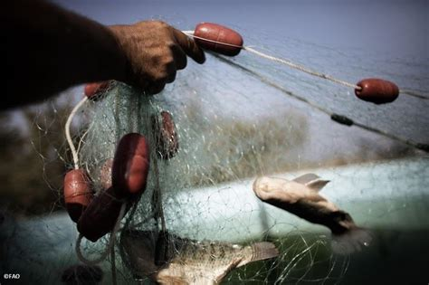

```{=html}
<link rel="shortcut icon" href="data/imageTitle.png" type="image/png">
<link rel="stylesheet" href="styles.css" type="text/css">
<style>
.back-link { font-size:0.9em; margin:20px 0 4px 0; }
.back-link a { color:#8e44ad; text-decoration:none; }
.back-link a:hover { text-decoration:underline; }
.proj-header { margin:20px 0 28px 0; }
.proj-header h1 { font-size:1.9em; font-weight:bold; color:#2c3e50; margin:0 0 16px 0; }
.proj-img {
  width:100%; max-height:320px; object-fit:cover;
  border:1px solid #ddd; border-radius:8px; margin-bottom:24px;
}
.proj-body p { font-size:1.05em; line-height:1.7; color:#444; }
.pub-box {
  display:grid; grid-template-columns:260px 1fr; gap:0;
  border:1px solid #e4e9f0; border-left:4px solid #8e44ad; border-radius:10px;
  overflow:hidden; margin:28px 0 12px 0; background:#fff;
  box-shadow:0 2px 10px rgba(0,0,0,0.05);
}
.pub-box-fig { background:#f7f9fc; display:flex; align-items:center; justify-content:center; }
.pub-box-fig img { width:100%; height:100%; object-fit:cover; display:block; }
.pub-box-body { padding:18px 22px; }
.pub-box-label { font-size:0.72em; font-weight:700; letter-spacing:.08em; text-transform:uppercase; color:#8e44ad; margin:0 0 6px 0; }
.pub-box-title { font-size:1.08em; font-weight:700; color:#2c3e50; line-height:1.35; margin:0 0 4px 0; }
.pub-box-ref { font-size:0.85em; color:#888; margin:0 0 10px 0; }
.pub-box-ref strong { color:#2c3e50; }
.pub-box-body p.pub-box-text { font-size:0.95em; line-height:1.6; color:#555; margin:0 0 12px 0; }
.pub-box-links { display:flex; flex-wrap:wrap; gap:8px; }
.pub-box-links a {
  font-size:0.82em; font-weight:600; padding:5px 12px; border-radius:7px;
  border:1px solid #dde3ea; color:#2c3e50 !important; text-decoration:none !important; background:#fff;
}
.pub-box-links a.pb-primary { background:#8e44ad; border-color:#8e44ad; color:#fff !important; }
.pub-box-links a:hover { opacity:.85; }
@media (max-width:720px) { .pub-box { grid-template-columns:1fr; } .pub-box-fig { max-height:220px; } }
</style>
<div class="back-link">← <a href="Projects.html">Back to Projects</a></div>
<div class="proj-header">
  <h1>Functional traits of species used by humans</h1>
</div>

<div class="proj-body">
<p>The objective of this project is to measure the functional traits of species used by humans — including commercially exploited fish and hunted vertebrates — in order to better assess and inform conservation policies.</p>
<p>This topic is developed by <strong>Pierre Bouchet</strong> (PhD Student, CRBE, 2024–2027): <em>Diversité fonctionnelle des vertébrés et utilisation par l'homme : liens entre traits fonctionnels, utilisation anthropique et crise de biodiversité.</em></p>
</div>
<div class="pub-box">
  <div class="pub-box-fig">
    
  </div>
  <div class="pub-box-body">
    <div class="pub-box-label">📰 Key publication · 2026</div>
    <div class="pub-box-title">Human targeting of morphologically unique fishes amplifies the risk of functional erosion</div>
    <div class="pub-box-ref">Bouchet P., Brosse S., <strong>Toussaint A.</strong> — <em>Nature Communications</em>, 17, 10697 · Open access</div>
    <p class="pub-box-text">Combining morphological traits of 8,970 freshwater fish species with their human uses, we show that the 2,334 species used by humans (26%) span 45% of the global morphospace, that fisheries, aquaculture, game fishing and the aquarium trade each target distinct body plans, and that aquaculture and game fishing favour morphologically original species. Losing the threatened species among them would erode freshwater fish morphological diversity about four times more than random extinctions.</p>
    <div class="pub-box-links">
      <a class="pb-primary" href="https://doi.org/10.1038/s41467-026-78568-9" target="_blank" rel="noopener">📄 Read the paper</a>
      <a href="data/2026_Bouchet_NatComm.pdf" target="_blank">⬇️ PDF</a>
      <a href="my-blog/site/posts/2026-10-19-human-use-unique-fishes/" target="_blank">🐟 Blog post</a>
      <a href="https://github.com/pierrolaloune/FishUsage" target="_blank" rel="noopener">💻 Code &amp; data</a>
    </div>
  </div>
</div>
```
