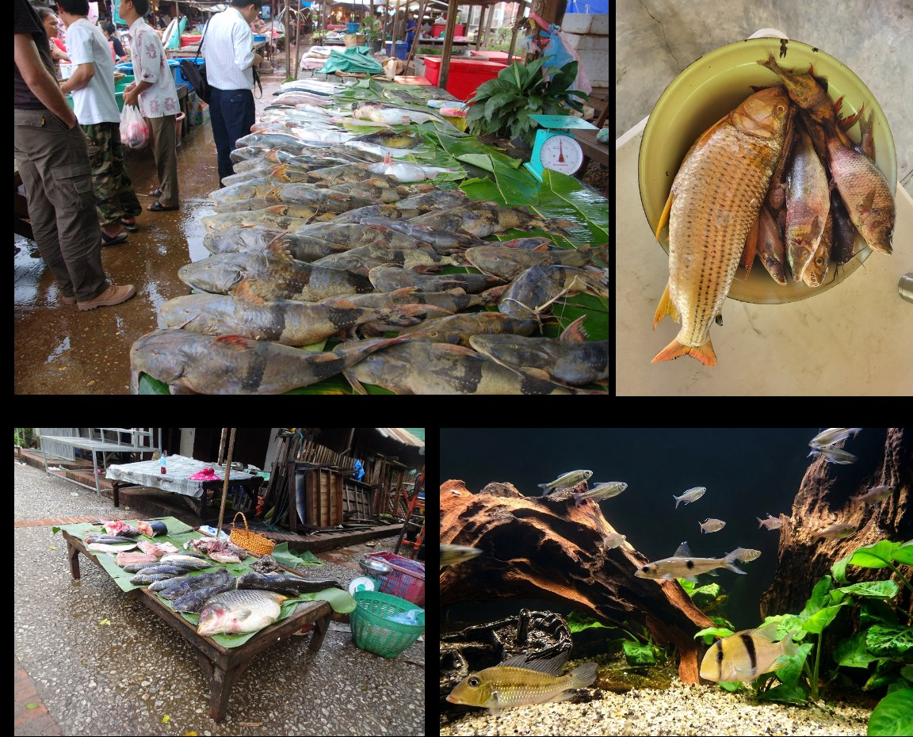

```{r setup, include=FALSE}
knitr::opts_chunk$set(echo = FALSE)
```

## Reference

🔗 Read the full open-access paper <a href="https://doi.org/10.1038/s41467-026-78568-9">here</a>

*Citation:* Bouchet P., Brosse S., **Toussaint A.** (2026). Human targeting of morphologically unique fishes amplifies the risk of functional erosion. *Nature Communications*, 17: 10697. <https://doi.org/10.1038/s41467-026-78568-9>

## Do we choose the fish we use at random?

For millennia, humans have drawn on nature to feed themselves, to heal, to have fun or simply to marvel. Freshwater fishes, with more than 18,000 described species, are no exception: inland fisheries provide an essential source of protein to more than 150 million people, while aquaculture, recreational angling and the aquarium trade each rely on hundreds of species.

Yet one question remained open: are the species we use interchangeable with the others, or do they carry ecological characteristics that no other species could replace if they were to disappear?

```{r echo=FALSE, out.width='100%', fig.cap="From market stalls to home aquaria: freshwater fishes are used by humans for food, fish farming, angling and ornamental purposes."}

```

## What we did

We combined two global databases. **FISHMORPH** describes eleven morphological traits (body size, body elongation, mouth size and position, eye size and position, fin shape and position…) for 8,970 freshwater fish species, and **FishBase** records the human uses of each species, which we grouped into four categories: fisheries, aquaculture, game fishing and the aquarium trade.

These traits are far from anecdotal. The shape of a fish directly reflects how it swims, how it feeds and how it interacts with its environment, in other words its role in the ecosystem. We built a global morphospace from these traits (four principal axes, 74% of trait variation), compared the volume and position occupied by each type of use with null models, related the probability that a species is used to its morphological distinctiveness, and finally simulated the extinction of threatened species according to their IUCN status.

## Key findings

- **Used species span a wide range of ecological strategies.** The 2,334 species used by humans (26% of the species studied) cover 45% of the global freshwater fish morphospace, a volume that does not differ from what an equivalent random set of species would occupy.
- **Each use has "its" type of fish.** The aquarium trade (1,505 species) selects small species with large eyes and an upturned mouth, like the guppy, and shows the strongest morphological clustering. Aquaculture (237 species) favours large, bottom-dwelling species with a downward-facing mouth, such as the African catfish. Game fishing (389 species) targets large, wide-mouthed predators such as the largemouth bass or the northern pike. Fisheries (1,688 species) exploit a much broader spectrum, from the small forage fishes of the African Great Lakes to the largest predators, with a clear shift towards large-bodied species.
- **Aquaculture and game fishing target the most original species.** Modelling the probability of use as a function of morphological distinctiveness, i.e. how far a species' shape is from all the others, shows that aquaculture and game fishing preferentially target species with rare trait combinations, often large ones. The signal is much weaker for fisheries and the aquarium trade, whose species pools are closer to the bulk of the morphospace.
- **Many of these species are threatened.** Among used species, 396 (17%) are threatened or near threatened according to the IUCN Red List (65 Critically Endangered, 117 Endangered, 121 Vulnerable, 93 Near Threatened), and another 139 are Data Deficient.
- **Their loss would erode fish morphological diversity four times more than chance.** Removing these species progressively, from the most to the least threatened, would shrink the global morphospace of freshwater fishes by 4.7%, compared with 1.1% on average when the same number of species is removed at random. This erosion would primarily affect the periphery of the morphospace, occupied by irreplaceable species such as sturgeons or giant Asian catfishes.

As Pierre puts it: *"The species we use the most are not 'ordinary' fishes: they are often the most original in terms of morphology, and therefore of ecological role. By targeting these species, many of which are already threatened, we risk losing ecological functions that nothing will be able to replace."*

## Use can also protect

The study also highlights a duality: use is not only a threat. The common carp, threatened in its native range, has become one of the most widespread fishes in the world thanks to aquaculture. In Brazil, community-based management of the arapaima fishery, a giant of Amazonian waters, has led to a 193% increase in its populations while improving the income of local communities.

## Why this matters

Our conservation policies assess species through their threat status or their trade volume, but remain blind to what they do in ecosystems. This study shows that, thanks to large trait databases, it is now possible to identify species that are at the same time used, threatened and functionally irreplaceable. Integrating this functional dimension into international frameworks such as FAO fisheries assessments or CITES would mean protecting not only species, but the very machinery of the ecosystems on which our societies depend.

## Data and code

All R scripts and data are available on GitHub ([pierrolaloune/FishUsage](https://github.com/pierrolaloune/FishUsage)) and archived on Zenodo ([10.5281/zenodo.21873314](https://doi.org/10.5281/zenodo.21873314)).

Congratulations to Pierre Bouchet, PhD student at CRBE, for leading this work, and many thanks to Sébastien Brosse and to the anonymous reviewers whose comments helped improve the manuscript.
